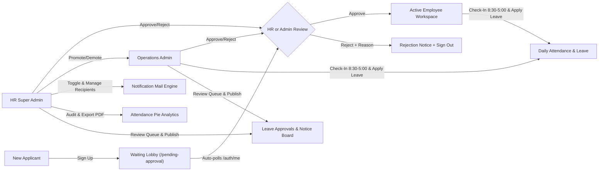

<div align="center">
  

  <h1>Next Hunt Management System</h1>
  <p>
    <strong>Enterprise-grade Workforce, Applicant Approval, Attendance Analytics, Leave &amp; Notice Management Platform</strong><br/>
    Built with <strong>Next.js 16</strong>, <strong>NestJS 12</strong>, <strong>MongoDB Atlas</strong>, <strong>Tailwind CSS 4</strong> &amp; <strong>Nodemailer</strong>.
  </p>

  <p>
    
    
    
    
    
    
  </p>
</div>

---

## Table of Contents

- [Overview](#overview)
- [Role Permission Matrix](#role-permission-matrix)
- [Use Cases](#use-cases)
- [Feature Case Studies](#feature-case-studies)
  - [Case Study 1: New Applicant Waiting Lobby & HR/Admin Approval Gate](#case-study-1-new-applicant-waiting-lobby--hradmin-approval-gate)
  - [Case Study 2: Strict 3-Tier Role Governance & Team Directory](#case-study-2-strict-3-tier-role-governance--team-directory)
  - [Case Study 3: Time-Windowed Daily Attendance Engine (8:30 AM – 5:00 PM)](#case-study-3-time-windowed-daily-attendance-engine-830-am--500-pm)
  - [Case Study 4: HR Executive Attendance Pie Chart & One-Click PDF Export](#case-study-4-hr-executive-attendance-pie-chart--one-click-pdf-export)
  - [Case Study 5: Structured Leave Management & Dual-Authority Review Queue](#case-study-5-structured-leave-management--dual-authority-review-queue)
  - [Case Study 6: Company Notice Board & Pinned Announcements](#case-study-6-company-notice-board--pinned-announcements)
  - [Case Study 7: HR Notification Mail Control Center & Dashboard Bell](#case-study-7-hr-notification-mail-control-center--dashboard-bell)
  - [Case Study 8: Unified Authentication, Email OTP Recovery & Direct Profile Password Change](#case-study-8-unified-authentication-email-otp-recovery--direct-profile-password-change)
  - [Case Study 9: High-Speed Caching Architecture & Executive UI Design System](#case-study-9-high-speed-caching-architecture--executive-ui-design-system)
- [Tech Stack](#tech-stack)
- [Project Structure](#project-structure)
- [Getting Started](#getting-started)
- [Seeded Accounts](#seeded-accounts)
- [API Reference](#api-reference)

---

## Overview

**Next Hunt Management System** is a full-stack, role-governed workforce operations platform built for organizations that need controlled onboarding approvals, punctual office-hour attendance tracking, accountable leave workflows, centralized company notices, configurable email alert routing, and executive-ready HR analytics.

### Key Highlights

- **Approval-Gated Employment Onboarding**: Self-registered accounts start as `Employee` with `pending` status and enter a live **Waiting Lobby** (`/pending-approval`) until **HR or Admin** approves or rejects them from the **Approvals** panel (`/dashboard/approvals`).
- **Strict 3-Tier Governance (`HR`, `Admin`, `Employee`)**:
  - **HR (Super Admin)** holds exclusive authority over role promotions/demotions (`Employee ↔ Admin`), the **Attendance Present vs. Absent Pie Chart + PDF Export**, manual attendance corrections, and the **Notification Mail** control center. HR focuses strictly on governance and does not submit personal attendance or leave requests.
  - **Admin** manages day-to-day operations—approving/rejecting new applicants and leave requests, publishing notices, viewing team rosters—while recording their own daily attendance and leave requests.
  - **Employee** records daily attendance within office hours, submits leave applications, reads company notices, and manages profile and password security.
- **Deterministic Office-Hours Attendance Policy**: Office hours run **9:00 AM – 5:00 PM**. The attendance portal opens at **8:30 AM**: check-ins between **8:30 AM – 9:10 AM** are marked **Present**, check-ins from **9:11 AM – 5:00 PM** are marked **Late**, and check-ins before **8:30 AM** or after **5:00 PM** are blocked until the next morning.
- **HR Attendance Pie Chart & Executive PDF Reports**: Interactive Recharts donut visualization with **Daily**, **7-Day**, and **30-Day** filters + date picker, paired with a high-resolution **jsPDF** executive report (branding, KPIs, rendered chart, and member breakdown table).
- **HR Notification Mail Control Center**: Dedicated HR-only section (`/dashboard/notification-mail`) to toggle registration notification emails **ON / OFF**, manage the exact list of recipient emails, and send live test alerts via **Nodemailer**.
- **Dual-Mode Password Security**: Unauthenticated **Forgot Password** on `/login` uses a 6-digit **Nodemailer** verification code (15-minute expiry), while authenticated users of all 3 roles change their password **directly** in **Profile & Security** using their current password (no email step required).
- **Instant Multi-Layer Caching**: Backend `CacheService` (30s TTL + write-through invalidation), batched `GET /dashboard/overview`, MongoDB connection pooling, and frontend synchronous SWR cache preloading deliver near-instant tab switching across HR, Admin, and Employee workspaces.

---

## Role Permission Matrix

| Capability | HR (Super Admin) | Admin | Employee | Pending / Rejected Applicant |
|---|:---:|:---:|:---:|:---:|
| Default Account Provisioning | Pre-approved on boot | Promoted by HR | Self Sign-Up *(requires approval)* | Waiting Lobby (`/pending-approval`) |
| Access Active Dashboard & Workspace APIs | **Yes** | **Yes** | **Yes** | No (`403 Forbidden`) |
| Approve / Reject New Employment Applicants | **Yes** | **Yes** | No | No |
| Permanently Delete Rejected / Team Accounts | **Yes (Exclusive)** | No | No | No |
| Upgrade / Change Role (`Employee ↔ Admin`) | **Yes (Exclusive)** | No (`403 Forbidden`) | No | No |
| Attendance Pie Chart & Executive PDF Export | **Yes (Exclusive)** | No | No | No |
| Manual Attendance Override (`POST /attendance/manual`) | **Yes (Exclusive)** | No | No | No |
| Record Daily Attendance (`8:30 AM – 5:00 PM`) | No *(`403` — Monitors Team)* | **Yes (Required)** | **Yes (Required)** | No |
| Apply for Leave | No *(`403` — Reviews Queue)* | **Yes** | **Yes** | No |
| Approve / Reject Leave Applications | **Yes** | **Yes** | No | No |
| Post, Edit, Pin & Delete Company Notices | **Yes** | **Yes** | View Only | No |
| Manage Registration Notification Mail (ON/OFF + Recipients) | **Yes (Exclusive)** | No | No | No |
| Receive In-App Dashboard Bell Notifications | **Yes** | **Yes** | **Yes** | No |
| Update Own Profile & Direct Password Change | **Yes** | **Yes** | **Yes** | No |
| Forgot Password via 6-Digit Email OTP (`/login`) | **Yes** | **Yes** | **Yes** | **Yes** |
| Sign Out / Session Logout | **Yes** | **Yes** | **Yes** | **Yes** |

---

## Use Cases

The platform is engineered around eight core real-world organizational workflows:



| ID | Use Case | Primary Actors | Trigger | End-to-End Business Outcome |
|---|---|---|---|---|
| **UC-01** | **Controlled New-Hire Onboarding** | New Applicant, HR, Admin | Applicant registers via `/login` (Sign Up tab) | Account is created in `pending` state, isolated in `/pending-approval`, HR/Admin notified; approval unlocks Employee workspace automatically within seconds without skewing headcount or attendance metrics while pending. |
| **UC-02** | **Punctual Daily Attendance Enforcement** | Employee, Admin, HR | Staff member arrives for 9:00 AM – 5:00 PM shift | Portal opens at 8:30 AM (`≤ 9:10 AM` = Present, `9:11 AM – 5:00 PM` = Late, `> 5:00 PM` = Closed). Duplicate punches are prevented and already checked-in staff can still check out. |
| **UC-03** | **Executive Attendance Auditing & Boardroom PDF** | HR (Super Admin) | HR reviews daily, 7-day, or 30-day presence | HR inspects Present vs. Absent ratios on an interactive donut chart and downloads a formatted PDF briefing containing KPI cards, chart graphics, and every active staff member's check-in/out log. |
| **UC-04** | **Structured Leave Application & Review** | Employee, Admin, HR | Staff requests Annual, Sick, Casual, Unpaid, or Emergency leave | Request enters HR/Admin review queue with computed day count; reviewer approves or rejects with a note, notifying the requester and reflecting approved leave in attendance analytics. |
| **UC-05** | **Role Governance & Privilege Separation** | HR (Super Admin), Admin | Organization promotes a senior Employee to Admin (or reverts an Admin) | Only HR can execute role changes (`Employee ↔ Admin`). Admins receive `403 Forbidden` if attempting privilege escalation; promoted users immediately gain Admin modules and receive an alert. |
| **UC-06** | **Configurable Registration Alert Routing** | HR (Super Admin), System Mailer | HR wants specific stakeholders notified on every new signup—or wants to mute emails temporarily | HR toggles registration mail ON/OFF and curates the exact recipient list in `/dashboard/notification-mail`, verifying delivery with a 1-click test email. |
| **UC-07** | **Official Company Announcements** | HR, Admin, Employee | Leadership publishes policy updates, holidays, or events | HR/Admin posts categorized, prioritized, optionally pinned notices; all active staff receive instant bell notifications and filterable access on the Notice Board. |
| **UC-08** | **Self-Service Account & Password Security** | HR, Admin, Employee | User forgets password at login or rotates password from profile | Forgotten passwords use a 6-digit Nodemailer OTP (15-min TTL) on `/login`; signed-in users update their password immediately from `/dashboard/profile` by confirming their current password. |

---

## Feature Case Studies

Below is a detailed case-study breakdown of every feature implemented across the **Next Hunt Management System** codebase.

---

### Case Study 1: New Applicant Waiting Lobby & HR/Admin Approval Gate

- **Business Challenge**: Open self-registration creates serious operational risks if unverified signups immediately gain access to internal notices, attendance logs, and team data—or worse, silently appear as "Absent" in HR's daily attendance reports before being hired.
- **Solution Implemented**:
  - Every public signup via `/login` is role-free (always `employee`) and persists with `approvalStatus: 'pending'` and `isApproved: false`.
  - Unapproved users are automatically routed to the executive **Waiting Lobby** (`/pending-approval`), displaying a 3-step onboarding tracker (*Application Submitted → HR & Admin Review → Workspace Unlocked*), full applicant dossier (`employeeCode`, email, department, role), manual **Check Status Now** trigger, and **8-second automatic polling** against `GET /auth/me`.
  - Both **HR** and **Admin** receive a persistent alert banner on the Overview page whenever `pendingApplicants > 0` and manage all candidates inside **Approvals** (`/dashboard/approvals`) with KPI cards, **Pending / Rejected / All** tabs, live search, 1-click **Approve**, a **Reject** modal with optional reason, **Re-Approve** support, and HR-only permanent deletion of rejected records.
  - Once approved, the applicant receives an approval email and their Waiting Lobby automatically redirects straight into `/dashboard`. If rejected, the Waiting Lobby renders the rejection state along with the reviewer's note.
- **Technical Architecture**:
  - Backend: [`approval-status.enum.ts`](backend/src/common/enums/approval-status.enum.ts), [`approved-user.guard.ts`](backend/src/common/guards/approved-user.guard.ts), [`users.controller.ts`](backend/src/users/users.controller.ts), [`users.service.ts`](backend/src/users/users.service.ts), [`attendance.service.ts`](backend/src/attendance/attendance.service.ts).
  - Frontend: [`pending-approval/page.tsx`](frontend/src/app/pending-approval/page.tsx), [`dashboard/approvals/page.tsx`](frontend/src/app/dashboard/approvals/page.tsx), [`dashboard/layout.tsx`](frontend/src/app/dashboard/layout.tsx).
- **Measurable Outcome**: Pending and rejected accounts are blocked at **both** the NestJS guard layer (`403 Forbidden` across every workspace endpoint) and the Next.js router layer, while HR's active staff count and Attendance Pie Chart remain 100% accurate by excluding non-approved applicants.

---

### Case Study 2: Strict 3-Tier Role Governance & Team Directory

- **Business Challenge**: Many internal HR tools suffer from blurred administrative boundaries—either allowing mid-level admins to grant themselves super-admin privileges, or forcing HR executives into employee attendance workflows they do not participate in.
- **Solution Implemented**:
  - **Three distinct operational tiers** (`hr`, `admin`, `employee`) enforced consistently on both API controllers (`@Roles(...)` + `RolesGuard`) and sidebar navigation (`NAV_ITEMS`).
  - **Auto-bootstrapped HR Super Admin**: On backend startup, `UsersService.ensureDefaultHrUser()` guarantees a pre-approved HR account exists without manual database edits.
  - **HR-Exclusive Role Authority**: Inside **Team & Roles** (`/dashboard/team`), only HR sees promotion/demotion actions (`Employee ↔ Admin`) and account deletion controls. Direct API calls by an Admin to `PATCH /users/:id/role` fail with `403 Forbidden`.
  - **Role-Authentic Boundaries**: HR is blocked (`403 Forbidden`) from personal attendance check-in/out and leave submission, keeping HR focused exclusively on governance, analytics, approvals, and configuration.
- **Technical Architecture**:
  - Backend: [`role.enum.ts`](backend/src/common/enums/role.enum.ts), [`roles.guard.ts`](backend/src/common/guards/roles.guard.ts), [`users.controller.ts`](backend/src/users/users.controller.ts), [`users.service.ts`](backend/src/users/users.service.ts).
  - Frontend: [`dashboard/team/page.tsx`](frontend/src/app/dashboard/team/page.tsx), [`dashboard/layout.tsx`](frontend/src/app/dashboard/layout.tsx).
- **Measurable Outcome**: Zero privilege-escalation vectors between Admin and HR, clean role separation across every UI view, and instant notification alerts whenever a team member's role is upgraded or adjusted.

---

### Case Study 3: Time-Windowed Daily Attendance Engine (`8:30 AM – 5:00 PM`)

- **Business Challenge**: Unconstrained check-in buttons allow staff to log attendance late at night or misrepresent on-time arrivals, creating manual reconciliation overhead for HR.
- **Solution Implemented**:
  - Standardized **Office Hours (`9:00 AM – 5:00 PM`)** enforced server-side via `evaluateAttendanceWindow()` and reflected live in the UI via a real-time client clock:
    - **Before `8:30 AM`**: Portal locked — check-in rejected (`400 Bad Request`).
    - **`8:30 AM – 9:10 AM` (inclusive)**: Check-in succeeds and is automatically classified as **`Present`**.
    - **`9:11 AM – 5:00 PM` (inclusive)**: Check-in succeeds and is automatically classified as **`Late`**.
    - **After `5:00 PM`**: Check-in portal closes until **8:30 AM** the next day (`400 Bad Request`), while staff who already checked in earlier may still record their **Check-Out** timestamp and total worked hours.
  - **Duplicate Prevention**: MongoDB compound unique index on `{ userId, date }` prevents double check-ins on the same day.
  - **HR Oversight & Manual Overrides**: HR monitors the full staff attendance roster (with date & role filters) and can submit manual corrections (`POST /attendance/manual`) when needed.
- **Technical Architecture**:
  - Backend: [`attendance.service.ts`](backend/src/attendance/attendance.service.ts), [`attendance.controller.ts`](backend/src/attendance/attendance.controller.ts), [`attendance.schema.ts`](backend/src/attendance/schemas/attendance.schema.ts).
  - Frontend: [`AttendancePunchCard.tsx`](frontend/src/components/AttendancePunchCard.tsx), [`dashboard/attendance/page.tsx`](frontend/src/app/dashboard/attendance/page.tsx).
- **Measurable Outcome**: 100% policy-compliant daily attendance logs with zero off-hours check-ins, automatic Present/Late classification, and accurate worked-hour tracking across both Employees and Admins.

---

### Case Study 4: HR Executive Attendance Pie Chart & One-Click PDF Export

- **Business Challenge**: HR leaders need an immediate visual pulse of workforce attendance and a clean way to share boardroom-ready attendance snapshots without manually building spreadsheets or screenshots—and traditional `html2canvas` exports frequently break on modern Tailwind CSS v4 `oklch()` color tokens.
- **Solution Implemented**:
  - **Interactive Present vs. Absent Donut Chart**: Exclusive to HR on both `/dashboard` and `/dashboard/attendance`, showing exact headcount, presence percentage, late check-in breakdown, approved-leave breakdown, and a synchronized staff roster table.
  - **Flexible Time Ranges**: One-click **Daily**, **7-Day**, and **30-Day** filters plus an interactive date selector (`GET /attendance/analytics?period=...&date=...`).
  - **Native Canvas + jsPDF Executive Report**: Clicking **Export PDF** generates a crisp, multi-section PDF document using **jsPDF 4** paired with a bespoke offscreen HTML5 `<canvas>` donut chart renderer—including Next Hunt Management System executive header, date/period metadata, KPI summary blocks, high-DPI Present vs. Absent chart, and complete member-by-member roster table.
- **Technical Architecture**:
  - Backend: [`attendance.service.ts`](backend/src/attendance/attendance.service.ts) (`getHrAnalytics()`).
  - Frontend: [`HrAttendancePieCard.tsx`](frontend/src/components/HrAttendancePieCard.tsx), [`pdf-report.ts`](frontend/src/lib/pdf-report.ts).
- **Measurable Outcome**: Zero CSS color-parsing crashes under Tailwind v4, instant visual clarity for HR leadership, and publication-quality downloadable PDF reports in a single click.

---

### Case Study 5: Structured Leave Management & Dual-Authority Review Queue

- **Business Challenge**: Informal email/chat leave requests are easily lost, lack audit trails, and disconnect approved time off from daily attendance visibility.
- **Solution Implemented**:
  - **Employee & Admin Leave Submission**: Staff apply for **Annual**, **Sick**, **Casual**, **Unpaid**, or **Emergency** leave with start/end dates, auto-calculated total days, and justification (`POST /leave`). Pending requests can be cancelled by the requester before review (`DELETE /leave/:id`).
  - **Dual-Authority Approval Queue**: Both **HR** and **Admin** inspect incoming leave applications with status filters (`All`, `Pending`, `Approved`, `Rejected`), approve or reject with an optional review note (`PATCH /leave/:id/approve`, `PATCH /leave/:id/reject`), and automatically notify the applicant via persistent dashboard notifications.
  - **Cross-Module Integration**: Approved leave records feed directly into HR's attendance analytics so HR distinguishes planned approved leave from unexcused absences.
- **Technical Architecture**:
  - Backend: [`leave.controller.ts`](backend/src/leave/leave.controller.ts), [`leave.service.ts`](backend/src/leave/leave.service.ts), [`leave-request.schema.ts`](backend/src/leave/schemas/leave-request.schema.ts).
  - Frontend: [`dashboard/leaves/page.tsx`](frontend/src/app/dashboard/leaves/page.tsx).
- **Measurable Outcome**: End-to-end auditable leave lifecycle with reviewer attribution (`reviewedBy`, `reviewedAt`, `reviewNote`) and zero orphaned requests.

---

### Case Study 6: Company Notice Board & Pinned Announcements

- **Business Challenge**: Important HR policies, townhall schedules, and holiday notices often get buried in chat threads, leaving employees unaware of critical updates.
- **Solution Implemented**:
  - **Centralized Editorial Notice Board** (`/dashboard/notices`) supporting **Categories** (`HR`, `Policy`, `Event`, `Holiday`, `General`), **Priorities** (`Normal`, `Important`, `Urgent`), and **Pinned** status so critical announcements remain anchored at the top.
  - **Role-Controlled Authoring**: **HR** and **Admin** can publish, edit, pin/unpin, and delete notices; **Employees** receive a clean, searchable, filterable read-only feed.
  - **Broadcast Alerts**: Publishing a notice triggers persistent bell notifications across active staff accounts and invalidates notice caches immediately.
- **Technical Architecture**:
  - Backend: [`notices.controller.ts`](backend/src/notices/notices.controller.ts), [`notices.service.ts`](backend/src/notices/notices.service.ts), [`notice.schema.ts`](backend/src/notices/schemas/notice.schema.ts).
  - Frontend: [`dashboard/notices/page.tsx`](frontend/src/app/dashboard/notices/page.tsx).
- **Measurable Outcome**: Guaranteed visibility for high-priority announcements with instant category filtering and full-text search.

---

### Case Study 7: HR Notification Mail Control Center & Dashboard Bell

- **Business Challenge**: Hardcoding a single environment email for registration notifications forces code redeploys whenever HR staffing changes—and gives HR no way to silence registration emails during bulk hiring drives or route alerts to multiple stakeholders.
- **Solution Implemented**:
  - **Dedicated HR-Only Section** (`/dashboard/notification-mail`, guarded by `@Roles(Role.HR)`):
    - **Master ON / OFF Toggle** (`PATCH /notification-mail/toggle`) persisted in MongoDB (`NotificationMailSettings`), letting HR enable or pause registration notification emails at any time.
    - **Recipient Directory Management** (`POST /notification-mail/recipients`, `DELETE /notification-mail/recipients`) with optional recipient labels (e.g., *HR Lead*, *Hiring Desk*), pre-seeded with `HR_NOTIFICATION_EMAIL`. When enabled, registration alerts are dispatched **exclusively** to HR's configured list via **Nodemailer** branded HTML templates.
    - **Live Test Dispatch** (`POST /notification-mail/test`) allowing HR to confirm SMTP connectivity and recipient delivery on demand.
  - **Persistent Dashboard Bell** (`NotificationBell`): Real-time unread badge and popover listing registrations, applicant approvals/rejections, leave decisions, company notices, and role promotions with single-item and **Mark All Read** actions.
- **Technical Architecture**:
  - Backend: [`notification-mail.controller.ts`](backend/src/notifications/notification-mail.controller.ts), [`notifications.controller.ts`](backend/src/notifications/notifications.controller.ts), [`notifications.service.ts`](backend/src/notifications/notifications.service.ts), [`notification-mail-settings.schema.ts`](backend/src/notifications/schemas/notification-mail-settings.schema.ts), [`mail.service.ts`](backend/src/mail/mail.service.ts).
  - Frontend: [`dashboard/notification-mail/page.tsx`](frontend/src/app/dashboard/notification-mail/page.tsx), [`NotificationBell.tsx`](frontend/src/components/NotificationBell.tsx).
- **Measurable Outcome**: Complete self-service control over outgoing registration email routing with zero downtime or `.env` edits required.

---

### Case Study 8: Unified Authentication, Email OTP Recovery & Direct Profile Password Change

- **Business Challenge**: Fragmented sign-in/sign-up/recovery routes create friction, while forcing already logged-in users through an SMTP OTP loop just to change their password slows down routine security hygiene.
- **Solution Implemented**:
  - **Single Unified Auth Experience** (`/login`, with `/register` redirecting cleanly): Seamlessly switches between **Sign In**, **Sign Up** (featuring a bespoke, keyboard-accessible `LuxurySelect` department selector), and **Forgot Password** alongside an editorial corporate hero panel.
  - **2-Step Email OTP Forgot Password**: Unauthenticated users request a **6-digit verification code** emailed via **Nodemailer** (stored hashed/expiring in 15 minutes), enter it in the custom 6-box `OtpCodeInput` widget, and set a new password (`POST /auth/forgot-password` → `POST /auth/reset-password`).
  - **Direct Profile Password Change (All 3 Roles)**: Inside **Profile & Security** (`/dashboard/profile`), **HR**, **Admin**, and **Employee** update their personal contact details (`PATCH /users/profile`) and update their password directly (`POST /auth/profile/change-password`) by verifying their current password—with live strength/match validation, show/hide toggles, and zero Nodemailer dependency.
  - **Dual-Transport JWT Sessions**: HTTP-only cookies paired with Bearer token support and instant session clearing on Sign Out.
- **Technical Architecture**:
  - Backend: [`auth.controller.ts`](backend/src/auth/auth.controller.ts), [`auth.service.ts`](backend/src/auth/auth.service.ts), [`jwt.strategy.ts`](backend/src/auth/strategies/jwt.strategy.ts).
  - Frontend: [`login/page.tsx`](frontend/src/app/login/page.tsx), [`dashboard/profile/page.tsx`](frontend/src/app/dashboard/profile/page.tsx), [`OtpCodeInput.tsx`](frontend/src/components/OtpCodeInput.tsx), [`LuxurySelect.tsx`](frontend/src/components/LuxurySelect.tsx).
- **Measurable Outcome**: Frictionless authentication and profile security tailored appropriately for both unauthenticated recovery and authenticated password updates.

---

### Case Study 9: High-Speed Caching Architecture & Executive UI Design System

- **Business Challenge**: Cloud-hosted MongoDB Atlas round-trips across multiple sequential dashboard requests previously caused noticeable initial latency (`600ms+`) and visible `"Loading..."` flashes when switching tabs across HR, Admin, and Employee accounts.
- **Solution Implemented**:
  - **Backend Performance Stack**:
    - Global in-memory [`CacheService`](backend/src/common/cache.service.ts) with 30-second TTL and automatic **write-through prefix invalidation** on every mutation (check-in/out, leave submission/review, notice CRUD, applicant approval/rejection, role change, profile update).
    - **Single Batched Overview Endpoint** (`GET /dashboard/overview`) aggregating all role-appropriate overview metrics, notices, attendance, leaves, and team stats in one parallelized server round-trip using `.lean()` MongoDB queries and connection pooling (`minPoolSize: 5`, `maxPoolSize: 20`).
    - **JWT Strategy Auth Cache** (30s TTL) preventing repetitive MongoDB lookups on concurrent API requests, invalidated instantly upon approval, rejection, role change, or deletion.
  - **Frontend Instant-Paint SWR Layer**:
    - Synchronous in-memory cache ([`cache.ts`](frontend/src/lib/cache.ts)) paired with `seedCachesFromOverview()` and background `preloadWorkspace()` so switching between **Overview**, **Attendance**, **Leave Requests**, **Notice Board**, **Team & Roles**, **Approvals**, and **Notification Mail** renders instantaneously without `"Loading..."` flashes while quietly revalidating fresh data.
  - **Executive Design System**:
    - Midnight Onyx (`#090B10`), Warm Alabaster (`#F6F5F1`), Burnished Champagne Gold (`#C9A25B`), Deep Forest Emerald (`#0F766E`), and Velvet Crimson (`#BE123C`).
    - Typography pairing **Manrope**, **Instrument Serif** (editorial italic), and **JetBrains Mono** (tabular numerals & Employee IDs).
    - Tailwind CSS v4 `@layer components` flex-framed `.nh-field-box` inputs (preventing icon/text overlap), bespoke corporate hero photography ([`corporate-discussion.jpg`](frontend/public/corporate-discussion.jpg)), and SSR hydration safety (`suppressHydrationWarning` + client-mounted clocks).
- **Measurable Outcome**: Warm API responses drop to **1–2 ms**, tab navigation renders synchronously in **0 ms** across HR, Admin, and Employee roles, and the UI remains visually cohesive across desktop and mobile viewports.

---

## Tech Stack

| Layer | Technologies |
|---|---|
| **Frontend** | Next.js `16.4.6` (App Router), React `19.3.1`, TypeScript `5.9`, Tailwind CSS `4.3.5`, Recharts `3.11.1`, jsPDF `4.2.1`, Lucide React `1.80`, Axios `1.21`, Zod `4.6`, React Hot Toast `2.6` |
| **Backend** | NestJS `12.6.1`, TypeScript `6.0.3`, Passport JWT (HTTP-only cookies + Bearer), bcryptjs `3.0.3`, Class Validator `0.15`, Swagger OpenAPI `12.1` |
| **Database** | MongoDB Atlas + `@nestjs/mongoose` `12.0.1` & Mongoose `9.13.1` |
| **Email Service** | Nodemailer `10.6.1` (Gmail SMTP with App Password) |

---

## Project Structure

```text
Employee-Management-System/
├── backend/
│   ├── src/
│   │   ├── attendance/         # Office-hours Check-in/out (8:30 AM – 5:00 PM), logs, manual override & HR Pie Analytics
│   │   ├── auth/               # JWT auth, unified register/login, 6-digit email OTP recovery & direct profile password change
│   │   ├── common/             # Roles/Approval/Attendance/Leave/Notice enums, RolesGuard, ApprovedUserGuard, CacheService
│   │   ├── dashboard/          # Single-round-trip batched GET /dashboard/overview aggregator
│   │   ├── database/           # MongoDB Atlas idempotent seed script
│   │   ├── leave/              # Leave applications & HR/Admin approve/reject workflow
│   │   ├── mail/               # Branded Nodemailer HTML email templates (welcome, alerts, decisions, OTP, test)
│   │   ├── notices/            # Company notice board CRUD + pinning & categories
│   │   ├── notifications/      # Persistent bell notifications + HR-only Notification Mail settings controller
│   │   ├── users/              # User schema, Waiting Lobby approval/rejection, HR-only role promotion & profile updates
│   │   ├── app.module.ts
│   │   └── main.ts
│   ├── nest-cli.json
│   ├── .env.example
│   └── package.json
├── frontend/
│   ├── public/
│   │   ├── corporate-discussion.jpg  # Bespoke corporate editorial photo for Auth hero panel
│   │   ├── logo.svg                  # Next Hunt Management System brand logo
│   │   └── favicon.svg               # Brand favicon
│   ├── src/
│   │   ├── app/
│   │   │   ├── icon.svg                      # Next.js App Router favicon
│   │   │   ├── login/                        # Unified Sign-In / Sign-Up / Forgot Password OTP page
│   │   │   ├── register/                     # Redirects to unified /login Sign Up tab
│   │   │   ├── pending-approval/             # Live Applicant Waiting Lobby (pending + rejected states)
│   │   │   └── dashboard/
│   │   │       ├── page.tsx                  # Role-tailored Overview (HR Pie Chart + Pending Applicant Alert Banner)
│   │   │       ├── attendance/               # Daily Attendance Punch Card + HR Analytics & Logs
│   │   │       ├── leaves/                   # Leave Applications & HR/Admin Review Queue
│   │   │       ├── notices/                  # Company Notice Board
│   │   │       ├── team/                     # Active Team Directory & HR-Only Role Management
│   │   │       ├── approvals/                # HR & Admin Employment Applicant Approvals Panel
│   │   │       ├── notification-mail/        # HR-Only Registration Mail Toggle & Recipient Manager
│   │   │       └── profile/                  # Personal Profile & Direct Change Password (All 3 Roles)
│   │   ├── components/                       # AttendancePunchCard, Badges, BrandLogo, HrAttendancePieCard, LuxurySelect, NotificationBell, OtpCodeInput
│   │   └── lib/                              # api.ts, auth-context.tsx, cache.ts (SWR + preload), pdf-report.ts, types.ts
│   ├── .env.example
│   └── package.json
├── start-dev.js                # Concurrent dev launcher for Backend (4000) + Frontend (3000)
└── README.md
```

---

## Getting Started

### Prerequisites

- **Node.js** `v20+` (tested on `v24.15.0`)
- **npm** `v10+`
- **MongoDB Atlas** cluster connection URI
- **Gmail App Password** for Nodemailer SMTP

### 1. Configure Environment Variables

Copy the example environment files and populate your credentials:

```bash
cp backend/.env.example backend/.env
cp frontend/.env.example frontend/.env.local
```

**`backend/.env` variables:**

```env
PORT=4000
NODE_ENV=development
MONGODB_URI=mongodb+srv://<user>:<password>@<cluster>.mongodb.net/next_hunt_ems?retryWrites=true&w=majority
JWT_SECRET=your_strong_secret_key
JWT_EXPIRATION=86400
SMTP_HOST=smtp.gmail.com
SMTP_PORT=587
SMTP_USER=your_gmail@gmail.com
SMTP_PASS=your_gmail_app_password
SMTP_FROM_NAME=Next Hunt Management System
HR_NOTIFICATION_EMAIL=your_hr_alert_email@gmail.com
DEFAULT_HR_NAME=HR Super Admin
DEFAULT_HR_EMAIL=hr@nexthunt.com
DEFAULT_HR_PASSWORD=NextHunt@HR123
FRONTEND_URL=http://localhost:3000
```

**`frontend/.env.local` variables:**

```env
NEXT_PUBLIC_API_URL=http://localhost:4000
NEXT_PUBLIC_APP_NAME=Next Hunt Management System
```

### 2. Install Dependencies

```bash
cd backend && npm install
cd ../frontend && npm install
```

### 3. Seed Sample Data *(Optional — Default HR Auto-Seeds on Boot)*

```bash
cd backend
npm run seed
```

### 4. Run Both Services

From the project root:

```bash
node start-dev.js
```

Or run them in separate terminals:

```bash
# Terminal 1 — NestJS API (http://localhost:4000 | Swagger: http://localhost:4000/api/docs)
cd backend && npm run start:dev

# Terminal 2 — Next.js UI (http://localhost:3000)
cd frontend && npm run dev
```

---

## Seeded Accounts

All seeded accounts below are created as pre-approved (`approvalStatus: 'approved'`) when running `npm run seed` (default HR is also auto-created on server boot):

| Name | Role | Department | Email | Password |
|---|---|---|---|---|
| **HR Super Admin** | `HR` (Super Admin) | Human Resources | `hr@nexthunt.com` | `NextHunt@HR123` |
| **Daniel Brooks** | `Admin` | Operations | `admin@nexthunt.com` | `NextHunt@123` |
| **Sarah Jenkins** | `Employee` | Engineering | `sarah@nexthunt.com` | `NextHunt@123` |
| **Marcus Chen** | `Employee` | Engineering | `marcus@nexthunt.com` | `NextHunt@123` |
| **Priya Nair** | `Employee` | Product Design | `priya@nexthunt.com` | `NextHunt@123` |
| **Liam O’Connor** | `Employee` | Growth & Marketing | `liam@nexthunt.com` | `NextHunt@123` |

---

## API Reference

Interactive OpenAPI / Swagger documentation is served live at **`http://localhost:4000/api/docs`**.

| Domain | Endpoints | Access Notes |
|---|---|---|
| **Auth & Security** | `POST /auth/register`, `POST /auth/login`, `POST /auth/logout`, `GET /auth/me`, `POST /auth/forgot-password`, `POST /auth/reset-password`, `POST /auth/profile/change-password`, `POST /auth/profile/request-password-code`, `POST /auth/profile/reset-password` | Public auth + JWT-protected session & password endpoints (`/auth/me` remains accessible to Waiting Lobby applicants) |
| **Dashboard (Batched)** | `GET /dashboard/overview?period=today\|week\|month&date=YYYY-MM-DD` | Approved users (role-tailored single-round-trip payload) |
| **Users, Approvals & Roles** | `GET /users`, `GET /users/stats`, `GET /users/applicants?status=all\|pending\|rejected`, `PATCH /users/:id/approve`, `PATCH /users/:id/reject`, `GET /users/:id`, `PATCH /users/profile`, `PATCH /users/:id/role`, `PATCH /users/:id`, `DELETE /users/:id` | Applicants & approvals: **HR & Admin**; Role changes, member edits & deletes: **HR Only** |
| **Attendance & Analytics** | `POST /attendance/check-in`, `POST /attendance/check-out`, `GET /attendance/today`, `GET /attendance/me`, `GET /attendance`, `GET /attendance/analytics`, `POST /attendance/manual` | Check-in/out & self logs: **Employee & Admin** (`8:30 AM – 5:00 PM`); Pie analytics & manual override: **HR Only** |
| **Leave Requests** | `POST /leave`, `GET /leave/me`, `GET /leave`, `PATCH /leave/:id/approve`, `PATCH /leave/:id/reject`, `DELETE /leave/:id` | Apply & self logs: **Employee & Admin**; Review queue & decisions: **HR & Admin** |
| **Notices** | `GET /notices`, `GET /notices/:id`, `POST /notices`, `PATCH /notices/:id`, `DELETE /notices/:id` | Read: **All Approved Roles**; Create, edit, pin & delete: **HR & Admin** |
| **Notifications** | `GET /notifications`, `PATCH /notifications/:id/read`, `PATCH /notifications/read-all` | All Approved Roles (scoped to current user) |
| **Notification Mail** | `GET /notification-mail`, `PATCH /notification-mail/toggle`, `POST /notification-mail/recipients`, `DELETE /notification-mail/recipients?email=...`, `POST /notification-mail/test` | **HR Super Admin Only** |

---

<div align="center">
  <sub>Built for Next Hunt Management System</sub>
</div>
